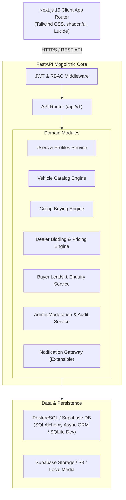
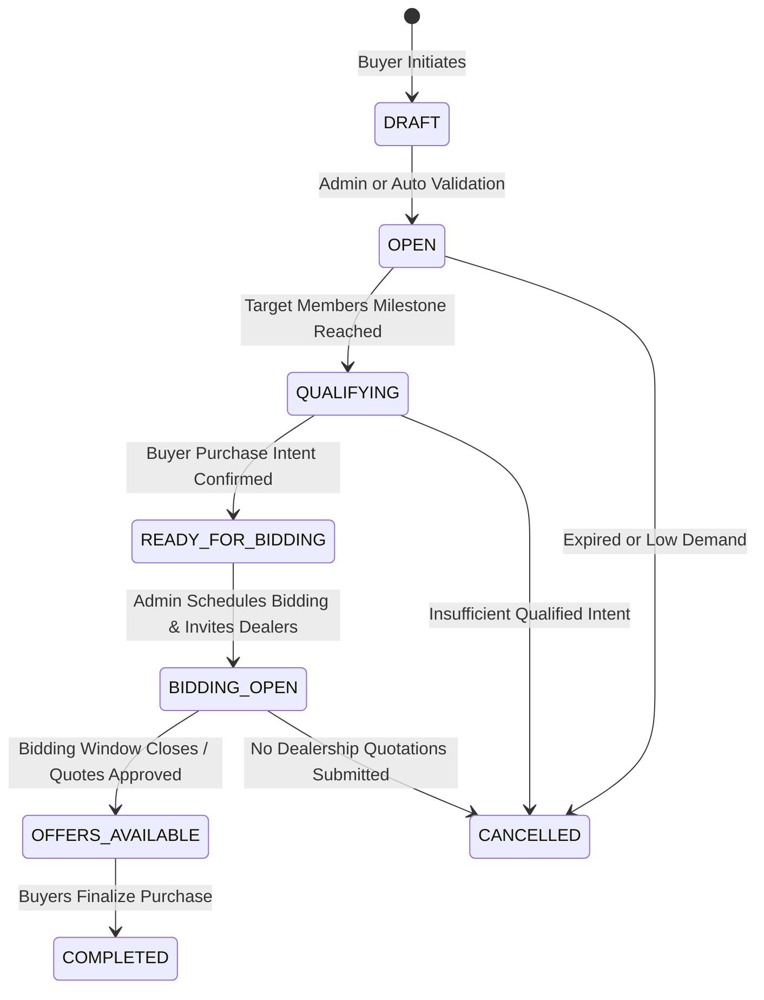
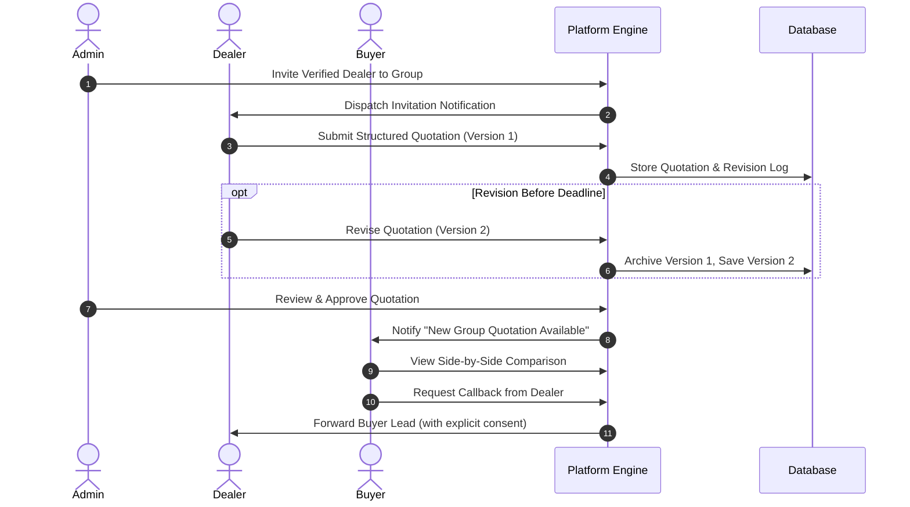

# System Architecture & Technical Design — GaadiLelo.com

## 1. Architectural Style: Modular Monolith

GaadiLelo adopts a clean **Modular Monolith** architecture. By avoiding premature microservice fragmentation, development velocity, database consistency, transaction atomicity, and testing ergonomics remain high, while clear domain boundaries prepare the codebase for future vertical decoupling when traffic demands.

---

## 2. Core Domain Engines

### 2.1 Group Buying Engine & State Machine

Buying groups transition across strictly controlled phases governed by both cohort milestones and operational sanity checks:

**State Definitions:**
1. `DRAFT`: Cohort created by buyer, awaiting initial validation.
2. `OPEN`: Live group actively gathering interested buyers in the selected city.
3. `QUALIFYING`: Target member count attained; platform initiates purchase-readiness check.
4. `READY_FOR_BIDDING`: Buyer intent verified; ready for dealer invitations.
5. `BIDDING_OPEN`: Authorized dealerships can submit and revise quotations until the deadline.
6. `OFFERS_AVAILABLE`: Admin has verified and published quotations; buyers compare side-by-side.
7. `COMPLETED`: Purchases fulfilled and confirmed by buyers and dealerships.
8. `CANCELLED`: Cohort lapsed or discontinued without meeting viable thresholds.

---

### 2.2 Vehicle-Agnostic Pricing Engine

To support diverse categories (from a ₹75,000 electric scooter to a ₹30,00,000 SUV or commercial truck), the pricing calculation handles conditional line items without hardcoded automobile assumptions:

$$\text{Final On-Road Price} = (\text{Ex-Showroom} + \text{RTO} + \text{Insurance} + \text{TCS} + \text{Handling} + \text{Accessories}) - (\text{Manufacturer Disc.} + \text{Dealer Disc.} + \text{Exchange Bonus} + \text{Corporate Bonus})$$

- **TCS (Tax Collected at Source):** Statutory 1% applies in India only when Ex-Showroom exceeds ₹10,00,000.
- **RTO / Registration:** Varies by vehicle type (e.g. 0% or nominal for EV 2-wheelers in certain states; standard slab for passenger ICE cars; commercial permit fees for trucks).
- **Insurance:** Varies by engine displacement (cc) or kW power rating, bundled 1-year Own Damage + 3/5-year Third Party depending on 2W vs 4W statutory norms.
- **Accessories:** Configurable line items categorized as `Mandatory`, `Optional`, or `Complimentary`.

---

### 2.3 Dealer Bidding & Quotation Lifecycle

---

## 3. Security & Access Control (RBAC)

Three discrete security scopes:
1. **BUYER:**
   - Read vehicles, browse active groups.
   - Create and join groups (strictly 1 active membership per group).
   - View only approved quotations for joined groups.
   - Request callbacks (triggering lead creation).
   - Cannot view other buyers' contact information or unapproved quotes.
2. **DEALER:**
   - Complete dealership profile and upload compliance documentation (GSTIN, trade certificates).
   - View exclusively groups where an active invitation has been issued.
   - Submit and revise quotations prior to bidding deadline.
   - View and update status of assigned customer leads.
   - Zero access to other dealerships' pending draft or internal margin details.
3. **ADMIN:**
   - Full moderation access: verify dealers, approve/reject quotations, trigger bidding windows, update group states, manage catalogue, view system audit logs.
