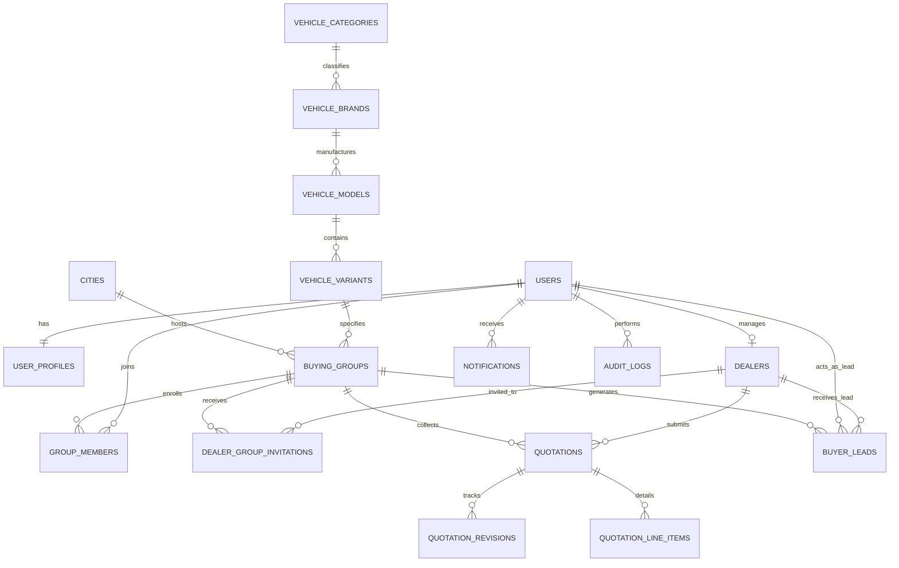

# Database Architecture & Schema Specification — GaadiLelo.com

## 1. Schema Overview

The database leverages relational integrity, UUID primary keys, temporal audit timestamps (`created_at`, `updated_at`), status enums, foreign key constraints with indexed lookup targets, and Supabase Row Level Security (RLS) policies.

---

## 2. Table Specifications

### 2.1 Identity & Authentication
- **`users`**:
  - `id`: UUID (Primary Key, Supabase Auth user ID or internal UUID).
  - `email`: VARCHAR(255) UNIQUE NOT NULL.
  - `password_hash`: VARCHAR(255) NULL (or handled by Supabase Auth).
  - `phone`: VARCHAR(20) UNIQUE NOT NULL.
  - `role`: ENUM ('BUYER', 'DEALER', 'ADMIN') DEFAULT 'BUYER'.
  - `is_active`: BOOLEAN DEFAULT TRUE.
  - `is_verified`: BOOLEAN DEFAULT FALSE.
  - `created_at`, `updated_at`: TIMESTAMPTZ.

- **`user_profiles`**:
  - `id`: UUID PRIMARY KEY.
  - `user_id`: UUID REFERENCES users(id) ON DELETE CASCADE UNIQUE.
  - `full_name`: VARCHAR(150) NOT NULL.
  - `city_id`: UUID REFERENCES cities(id).
  - `preferred_language`: VARCHAR(10) DEFAULT 'en'.
  - `communication_consent`: BOOLEAN DEFAULT TRUE.
  - `created_at`, `updated_at`: TIMESTAMPTZ.

- **`dealers`**:
  - `id`: UUID PRIMARY KEY.
  - `user_id`: UUID REFERENCES users(id) ON DELETE CASCADE UNIQUE.
  - `dealership_name`: VARCHAR(255) NOT NULL.
  - `legal_entity_name`: VARCHAR(255) NOT NULL.
  - `gstin`: VARCHAR(15) UNIQUE NOT NULL.
  - `city_id`: UUID REFERENCES cities(id) NOT NULL.
  - `address`: TEXT NOT NULL.
  - `authorized_brands`: JSONB NOT NULL DEFAULT '[]'.
  - `verification_status`: ENUM ('PENDING', 'VERIFIED', 'REJECTED') DEFAULT 'PENDING'.
  - `verification_notes`: TEXT NULL.
  - `verified_at`: TIMESTAMPTZ NULL.
  - `created_at`, `updated_at`: TIMESTAMPTZ.

- **`dealer_documents`**:
  - `id`: UUID PRIMARY KEY.
  - `dealer_id`: UUID REFERENCES dealers(id) ON DELETE CASCADE.
  - `document_type`: ENUM ('GST_CERTIFICATE', 'OEM_DEALERSHIP_AGREEMENT', 'PAN_CARD', 'TRADE_LICENSE', 'BANK_PROOF').
  - `file_url`: TEXT NOT NULL.
  - `verification_status`: ENUM ('PENDING', 'ACCEPTED', 'REJECTED') DEFAULT 'PENDING'.
  - `created_at`: TIMESTAMPTZ.

---

### 2.2 Geography & Vehicle Catalog
- **`cities`**:
  - `id`: UUID PRIMARY KEY.
  - `name`: VARCHAR(100) NOT NULL.
  - `state`: VARCHAR(100) NOT NULL.
  - `pincode_prefix`: VARCHAR(10).
  - `is_active`: BOOLEAN DEFAULT TRUE (Indore initial active city).

- **`vehicle_categories`**:
  - `id`: UUID PRIMARY KEY.
  - `slug`: VARCHAR(50) UNIQUE NOT NULL ('two-wheeler', 'three-wheeler', 'car', 'commercial-vehicle', 'electric-vehicle').
  - `name`: VARCHAR(100) NOT NULL.
  - `description`: TEXT.
  - `icon_name`: VARCHAR(50).

- **`vehicle_brands`**:
  - `id`: UUID PRIMARY KEY.
  - `category_id`: UUID REFERENCES vehicle_categories(id).
  - `name`: VARCHAR(100) NOT NULL.
  - `slug`: VARCHAR(100) UNIQUE NOT NULL.
  - `logo_url`: TEXT.

- **`vehicle_models`**:
  - `id`: UUID PRIMARY KEY.
  - `brand_id`: UUID REFERENCES vehicle_brands(id) ON DELETE CASCADE.
  - `name`: VARCHAR(150) NOT NULL.
  - `slug`: VARCHAR(150) UNIQUE NOT NULL.
  - `body_type`: VARCHAR(50) (e.g. Scooter, Hatchback, Compact SUV, LCV).
  - `image_url`: TEXT.
  - `is_active`: BOOLEAN DEFAULT TRUE.

- **`vehicle_variants`**:
  - `id`: UUID PRIMARY KEY.
  - `model_id`: UUID REFERENCES vehicle_models(id) ON DELETE CASCADE.
  - `name`: VARCHAR(150) NOT NULL (e.g. 'XZ Plus Dual Tone', 'VXi', 'Pro Electric').
  - `fuel_type`: ENUM ('PETROL', 'DIESEL', 'CNG', 'ELECTRIC', 'HYBRID').
  - `transmission`: ENUM ('MANUAL', 'AUTOMATIC', 'AMT', 'CVT', 'DCT', 'SINGLE_SPEED_EV').
  - `seating_capacity`: INT DEFAULT 5.
  - `engine_cc_or_battery_kwh`: VARCHAR(50).
  - `reference_ex_showroom`: NUMERIC(12, 2) NOT NULL.
  - `specifications`: JSONB DEFAULT '{}'.
  - `is_active`: BOOLEAN DEFAULT TRUE.

---

### 2.3 Group Buying & Membership
- **`buying_groups`**:
  - `id`: UUID PRIMARY KEY.
  - `group_code`: VARCHAR(30) UNIQUE NOT NULL (e.g. 'GL-IND-TATANEX-001').
  - `vehicle_variant_id`: UUID REFERENCES vehicle_variants(id).
  - `city_id`: UUID REFERENCES cities(id).
  - `created_by_user_id`: UUID REFERENCES users(id).
  - `status`: ENUM ('DRAFT', 'OPEN', 'QUALIFYING', 'READY_FOR_BIDDING', 'BIDDING_OPEN', 'OFFERS_AVAILABLE', 'COMPLETED', 'CANCELLED') DEFAULT 'OPEN'.
  - `target_members`: INT NOT NULL DEFAULT 5.
  - `current_members_count`: INT NOT NULL DEFAULT 1.
  - `target_purchase_timeline`: VARCHAR(50) NOT NULL ('WITHIN_15_DAYS', 'WITHIN_30_DAYS', 'WITHIN_60_DAYS').
  - `bidding_start_time`: TIMESTAMPTZ NULL.
  - `bidding_end_time`: TIMESTAMPTZ NULL.
  - `additional_notes`: TEXT NULL.
  - `created_at`, `updated_at`: TIMESTAMPTZ.

- **`group_members`**:
  - `id`: UUID PRIMARY KEY.
  - `group_id`: UUID REFERENCES buying_groups(id) ON DELETE CASCADE.
  - `user_id`: UUID REFERENCES users(id) ON DELETE CASCADE.
  - `buyer_notes`: TEXT NULL.
  - `status`: ENUM ('ACTIVE', 'QUALIFIED', 'WITHDRAWN', 'PURCHASED') DEFAULT 'ACTIVE'.
  - `joined_at`: TIMESTAMPTZ DEFAULT NOW().
  - UNIQUE(group_id, user_id) -- Duplicate membership prevention.

---

### 2.4 Bidding, Quotations & Line Items
- **`dealer_group_invitations`**:
  - `id`: UUID PRIMARY KEY.
  - `group_id`: UUID REFERENCES buying_groups(id) ON DELETE CASCADE.
  - `dealer_id`: UUID REFERENCES dealers(id) ON DELETE CASCADE.
  - `status`: ENUM ('INVITED', 'ACCEPTED', 'DECLINED', 'SUBMITTED') DEFAULT 'INVITED'.
  - `invited_at`: TIMESTAMPTZ DEFAULT NOW().
  - UNIQUE(group_id, dealer_id).

- **`quotations`**:
  - `id`: UUID PRIMARY KEY.
  - `group_id`: UUID REFERENCES buying_groups(id) ON DELETE CASCADE.
  - `dealer_id`: UUID REFERENCES dealers(id) ON DELETE CASCADE.
  - `revision_number`: INT DEFAULT 1.
  - `status`: ENUM ('DRAFT', 'SUBMITTED', 'APPROVED', 'REJECTED', 'SUPERSEDED') DEFAULT 'SUBMITTED'.
  - `admin_review_notes`: TEXT NULL.
  - `base_ex_showroom`: NUMERIC(12, 2) NOT NULL.
  - `rto_road_tax`: NUMERIC(12, 2) NOT NULL DEFAULT 0.
  - `insurance_amount`: NUMERIC(12, 2) NOT NULL DEFAULT 0.
  - `tcs_amount`: NUMERIC(12, 2) NOT NULL DEFAULT 0.
  - `mfg_discount`: NUMERIC(12, 2) NOT NULL DEFAULT 0.
  - `dealer_discount`: NUMERIC(12, 2) NOT NULL DEFAULT 0.
  - `exchange_bonus`: NUMERIC(12, 2) NOT NULL DEFAULT 0.
  - `corporate_discount`: NUMERIC(12, 2) NOT NULL DEFAULT 0.
  - `accessories_amount`: NUMERIC(12, 2) NOT NULL DEFAULT 0.
  - `logistics_handling`: NUMERIC(12, 2) NOT NULL DEFAULT 0.
  - `other_statutory_charges`: NUMERIC(12, 2) NOT NULL DEFAULT 0.
  - `final_on_road_price`: NUMERIC(12, 2) NOT NULL.
  - `delivery_timeline_days`: INT NOT NULL.
  - `offer_valid_until`: TIMESTAMPTZ NOT NULL.
  - `remarks`: TEXT NULL.
  - `created_at`, `updated_at`: TIMESTAMPTZ.

- **`quotation_revisions`**:
  - `id`: UUID PRIMARY KEY.
  - `quotation_id`: UUID REFERENCES quotations(id) ON DELETE CASCADE.
  - `revision_number`: INT NOT NULL.
  - `snapshot`: JSONB NOT NULL (Complete state copy before revision).
  - `revised_at`: TIMESTAMPTZ DEFAULT NOW().
  - `revised_by_user_id`: UUID REFERENCES users(id).

- **`quotation_line_items`**:
  - `id`: UUID PRIMARY KEY.
  - `quotation_id`: UUID REFERENCES quotations(id) ON DELETE CASCADE.
  - `item_name`: VARCHAR(150) NOT NULL.
  - `item_type`: ENUM ('MANDATORY', 'OPTIONAL', 'COMPLIMENTARY', 'DISCOUNT').
  - `amount`: NUMERIC(12, 2) NOT NULL.

---

### 2.5 Buyer Leads, Notifications & Governance
- **`buyer_leads`**:
  - `id`: UUID PRIMARY KEY.
  - `group_id`: UUID REFERENCES buying_groups(id).
  - `buyer_id`: UUID REFERENCES users(id).
  - `dealer_id`: UUID REFERENCES dealers(id).
  - `quotation_id`: UUID REFERENCES quotations(id).
  - `status`: ENUM ('PENDING_CALLBACK', 'CONTACTED', 'TEST_DRIVE_SCHEDULED', 'BOOKING_IN_PROGRESS', 'PURCHASE_COMPLETED', 'LOST') DEFAULT 'PENDING_CALLBACK'.
  - `buyer_consent_given`: BOOLEAN DEFAULT TRUE.
  - `notes`: TEXT NULL.
  - `created_at`, `updated_at`: TIMESTAMPTZ.

- **`notifications`**:
  - `id`: UUID PRIMARY KEY.
  - `user_id`: UUID REFERENCES users(id) ON DELETE CASCADE.
  - `title`: VARCHAR(200) NOT NULL.
  - `message`: TEXT NOT NULL.
  - `event_type`: VARCHAR(100) NOT NULL.
  - `link_url`: TEXT NULL.
  - `is_read`: BOOLEAN DEFAULT FALSE.
  - `created_at`: TIMESTAMPTZ DEFAULT NOW().

- **`complaints`**:
  - `id`: UUID PRIMARY KEY.
  - `submitted_by_user_id`: UUID REFERENCES users(id).
  - `target_dealer_id`: UUID REFERENCES dealers(id) NULL;
  - `group_id`: UUID REFERENCES buying_groups(id) NULL;
  - `subject`: VARCHAR(200) NOT NULL.
  - `description`: TEXT NOT NULL.
  - `status`: ENUM ('OPEN', 'INVESTIGATING', 'RESOLVED', 'DISMISSED') DEFAULT 'OPEN'.
  - `created_at`, `updated_at`: TIMESTAMPTZ.

- **`audit_logs`**:
  - `id`: UUID PRIMARY KEY.
  - `actor_user_id`: UUID REFERENCES users(id).
  - `action`: VARCHAR(100) NOT NULL.
  - `entity_type`: VARCHAR(100) NOT NULL.
  - `entity_id`: UUID NOT NULL.
  - `payload`: JSONB DEFAULT '{}'.
  - `ip_address`: VARCHAR(45).
  - `created_at`: TIMESTAMPTZ DEFAULT NOW().
