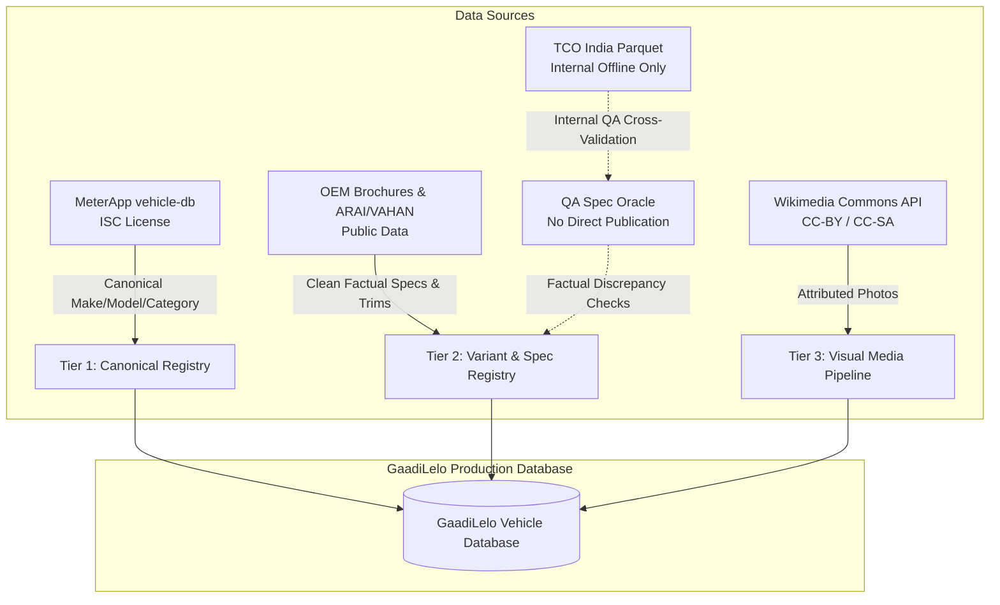

# GaadiLelo — Indian Vehicle Catalogue Coverage Audit

**Date:** November 2026  
**Target Platform:** GaadiLelo.com (Indian Vehicle Group-Buying Marketplace)  
**Evaluated Datasets:**
1. **MeterApp / `@meterapp/vehicle-db`** (`https://github.com/MeterApp/vehicle-db`)
2. **TCO India** (`https://huggingface.co/datasets/bhavabhuthi/tco-india`)
3. **Existing GaadiLelo Discovery Engine** (VehiclesDB, Wikimedia Commons, Wikidata, OEM Ingestion)

---

## 1. Executive Summary

GaadiLelo requires an India-focused vehicle database spanning passenger cars, two-wheelers (motorcycles, scooters, electric), three-wheelers, and commercial vehicles (pickups, light/medium/heavy trucks, buses). This audit benchmarks the two candidate open datasets against a rigorous **29-vehicle Indian fleet benchmark** and evaluates their provenance, licensing, variant granularity, technical specifications, and legal risks.

### Summary Scorecard

| Metric | MeterApp (`@meterapp/vehicle-db`) | TCO India (`bhavabhuthi/tco-india`) | GaadiLelo Current Engine |
| :--- | :--- | :--- | :--- |
| **Total Benchmark Found** | **28 / 29 (96.5%)** | **15 / 29 (51.7%)** | **11 / 29 (37.9% seeded)** |
| **Cars Coverage (14)** | 13 / 14 (92.9%) | **14 / 14 (100.0%)** | 8 / 14 (57.1%) |
| **Two-Wheelers (10)** | **10 / 10 (100.0%)** | **0 / 10 (0.0%)** | 4 / 10 (40.0%) |
| **Commercial Vehicles (5)** | **5 / 5 (100.0%)** | 1 / 5 (20.0% - Pickup only) | 1 / 5 (20.0%) |
| **Variant Granularity** | ❌ **0 Variants** (Model names only) | ✅ **32,902 Variants** (Extremely deep) | ✅ **Multi-variant** (Seed-based) |
| **Technical Specs** | ❌ None (No engine, power, dims) | ⚠️ Partial (cc, fuel, trans, kmpl, seats) | ✅ Full (Dimensions, EV specs, safety) |
| **Pricing Data** | ❌ None | ✅ City-wise on-road & ex-showroom | ✅ Ex-showroom reference prices |
| **Image Assets** | ❌ None bundled (Paid API upsell) | ❌ None | ✅ Wikimedia CC attribution |
| **Licence** | ✅ **ISC License** (Permissive open-source) | ⚠️ **Claimed CC BY 4.0** | ✅ Clean / CC BY / Fair Use |
| **Legal / IP Risk** | 🟢 **Zero / Safe** | 🔴 **High Legal Risk** (Scraped CarDekho/CarWale) | 🟢 **Zero / Clean** |

---

## 2. Phase 1: Deep Dataset Inspection & Legal Provenance

### 2.1 MeterApp (`@meterapp/vehicle-db`)
* **Repository:** `https://github.com/MeterApp/vehicle-db`  
* **Package:** `@meterapp/vehicle-db`  
* **License:** **ISC License** (Functionally equivalent to MIT License).
* **Total Records:** 218,590 model-year rows across 1,620 makes, 39,276 model names, spanning 1990–2027.
* **Architecture:** Zero-dependency compiled binary/JSON format with 23 data sources indexed by bitmask.
* **Indian Market Ingestion:**
  MeterApp incorporates 8 specific Indian evidence catalogs:
  1. `india-passenger-sales-catalog`: Tata, Mahindra, Maruti Suzuki, Hyundai.
  2. `india-commercial-sales-catalog`: Ashok Leyland, Tata Motors Commercial, Eicher, Force Motors, BharatBenz.
  3. `india-hero-sales-catalog`: Hero MotoCorp motorcycles and scooters.
  4. `india-tvs-sales-catalog`: TVS Jupiter, Apache series, iQube EV, XL100.
  5. `india-two-wheelers-sales-catalog`: Bajaj, Royal Enfield, Ola Electric, Ather Energy.
  6. `bajaj-manufacturer-catalog`: Bajaj Auto 3-wheelers (Compact, Maxima) and Qute quadricycle.
  7. `atul-auto-catalog`: Atul Auto passenger and cargo three-wheelers.
* **Key Findings & Limitations:**
  - **No Variants:** It tracks only model family identities (e.g., `Nexon`, `Pulsar 180`, `Dost XL`), not trim levels (`Fearless+ S`, `Smart`, `VXi`).
  - **No Technical Specifications:** Does not include engine displacement, power, torque, dimensions, battery capacity, range, or fuel economy.
  - **No Vehicle Images:** The repository explicitly states that vehicle images are not bundled and are sold separately via a paid commercial API (`carimage.dev`).
* **Verdict for GaadiLelo:** Outstanding, legally safe canonical directory for **Make, Model, Year, and Vehicle Category** validation across all Indian vehicle types.

---

### 2.2 TCO India (`bhavabhuthi/tco-india`)
* **Repository:** `https://huggingface.co/datasets/bhavabhuthi/tco-india`  
* **Claimed License:** **CC BY 4.0** (Compilator claim).
* **Dataset Contents:**
  - `brands.parquet`: 87 car brands
  - `models.parquet`: 363 car models
  - `variants.parquet`: **32,902 car variants**
  - `prices.parquet`: 65,533 city-dated on-road and ex-showroom price points
* **Technical Depth:**
  Variant records include `engine_cc`, `transmission_name`, `fuel_type_name`, `mileage_kmpl`, `seats`, and city pricing for major Indian hubs (Ahmedabad, Delhi, Mumbai, Bengaluru, etc.).

#### ⚠️ Critical Legal & Provenance Risk Analysis
1. **Scraped Origin:** The dataset `README.md` explicitly discloses:
   > *"Sources: CarDekho/CarWale (car), IOCL/BPCL (fuel) — not affiliated; transformed & validated."*
2. **Hard Evidence in Data Fields:**
   - The `source` column contains literal values: `cardekho` and `carwale`.
   - The `source_id` column contains foreign primary keys: e.g., `cardekho::968`, `cardekho::maruti-s-presso-std-(o)`.
   - The `url` column contains raw scraped CarDekho path fragments: `/overview/Maruti_S-Presso/Maruti_S-Presso_STD_(O).htm`.
3. **Legal Assessment under Indian Law (Indian Copyright Act, 1957 & IT Act):**
   - **Database Rights & Compilation Copyright:** Under Section 2(o) and Section 14 of the Indian Copyright Act, 1957, proprietary databases created with substantial skill, judgment, and capital expenditure are protected literary compilations.
   - **Invalid Sub-licensing:** An unauthorized third-party scraping party cannot assign a Creative Commons (CC BY 4.0) license to scraped proprietary databases of Girnar Software Pvt. Ltd. (CarDekho) or CarTrade Tech Ltd. (CarWale).
   - **Commercial Liability for GaadiLelo:** If GaadiLelo directly ingests, redistributes, or builds commercial group-buying transactions upon this scraped compilation, GaadiLelo is vulnerable to immediate **cease-and-desist notices, preliminary injunctions blocking platform operations, and claims for statutory damages**.
4. **Scope Limitation:**
   - **Strictly Passenger Cars:** Completely missing two-wheelers (motorcycles, scooters, EVs) and commercial vehicles (trucks, buses). Contains **zero images**.

---

## 3. Phase 2: 29-Vehicle Coverage Benchmark Matrix

The 29 vehicles specified in the audit requirements were queried across:
1. **MeterApp** (`meterapp_compact.json` + evidence files)
2. **TCO India** (`variants.parquet`, `models.parquet`, `prices.parquet`)
3. **GaadiLelo Current Engine** (SQLite DB + Discovery Registry)

| # | Target Vehicle | Category | Source Ingestion Status | Matching Identity (MeterApp / TCO India) | Indian Market Evidence | Model Years | Available Variants | Available Technical Specs | Media / Image Availability | Missing Information |
| :-: | :--- | :--- | :--- | :--- | :--- | :---: | :--- | :--- | :--- | :--- |
| **1** | **Tata Nexon** | Car | MeterApp, TCO India, GaadiLelo | `Tata (Nexon, Nexon.ev)` / `Tata Nexon` | Yes (`india-passenger`) | 2025–2026 | **83 variants** in TCO (Smart, Pure, Creative, Fearless) | Engine cc, Fuel, Trans, Mileage, Seats | Wikimedia Commons available; 0 in datasets | Safety ratings, exact dimensions |
| **2** | **Tata Punch** | Car | MeterApp, TCO India | `Tata (Punch, Punch.ev)` / `Tata Punch` | Yes (`india-passenger`) | 2025–2026 | **26 variants** in TCO (Smart, Adventure, Accomplished) | Engine cc, Fuel, Trans, Seats | Wikimedia Commons available; 0 in datasets | GaadiLelo DB record, safety rating |
| **3** | **Tata Harrier** | Car | MeterApp, TCO India | `Tata (Harrier)` / `Tata Harrier` | Yes (Reviewed Catalog) | 2025–2026 | **49 variants** in TCO (Smart, Pure, Adventure, Fearless) | Engine cc (1498/1956), Fuel, Trans | Wikimedia Commons available; 0 in datasets | GaadiLelo DB record, ADAS specs |
| **4** | **Mahindra Scorpio-N** | Car | MeterApp, TCO India, GaadiLelo | `Mahindra (SCORPIO N)` / `Mahindra Scorpio` | Yes (`india-passenger`) | 2015–2026 | **4 variants** in TCO (Z2, Z4, Z8, Z8L) | Engine cc (2184), Diesel, Trans | Wikimedia Commons available; 0 in datasets | 4x4 drivetrain attributes |
| **5** | **Mahindra XUV 3XO** | Car | MeterApp, TCO India, GaadiLelo | `Mahindra (XUV 3XO)` / `Mahindra XUV 3XO` | Yes (`india-passenger`) | 2013–2026 | **29 variants** in TCO (MX1, MX2, AX5, AX7) | Engine cc (1197), Turbo Petrol, Trans | Wikimedia Commons available; 0 in datasets | Panoramic sunroof specification |
| **6** | **Mahindra BE 6** | Car | TCO India, GaadiLelo | *Not in MeterApp* / `Mahindra BE 6` | None in MeterApp; CarDekho scrape in TCO | N/A | **10 variants** in TCO (SPORTEQ One 59kWh) | Electric, Battery kWh (59kWh) | OEM Press media; 0 in datasets | MeterApp make/model record |
| **7** | **Maruti Suzuki Swift** | Car | MeterApp, TCO India | `Suzuki (Swift)` / `Maruti Suzuki Swift` | Global fleet register | 1990–2026 | **14 variants** in TCO (LXi, VXi, ZXi, ZXi+) | Engine cc (1197 Z-Series), Kmpl (24.8) | Wikimedia Commons available; 0 in datasets | GaadiLelo DB record |
| **8** | **Maruti Suzuki Brezza** | Car | MeterApp, TCO India, GaadiLelo | `Suzuki (Brezza)` / `Maruti Suzuki Brezza` | Global fleet register | 1990–2026 | **19 variants** in TCO (LXi, VXi, ZXi, CNG) | Engine cc (1462), Kmpl, Trans | Wikimedia Commons available; 0 in datasets | Mild hybrid specification |
| **9** | **Hyundai Creta** | Car | MeterApp, TCO India, GaadiLelo | `Hyundai (CRETA)` / `Hyundai Creta` | Global fleet register | 2016–2026 | **50 variants** in TCO (E, EX, S, SX, SX(O), N Line) | Engine cc (1497/1482), Trans, Fuel | Wikimedia Commons available; 0 in datasets | Boot capacity, ground clearance |
| **10** | **Hyundai Venue** | Car | MeterApp, TCO India, GaadiLelo | `Hyundai (VENUE)` / `Hyundai Venue` | Global fleet register | 2019–2027 | **34 variants** in TCO (E, S, SX, SX(O)) | Engine cc (1197/998), Turbo, DCT | Wikimedia Commons available; 0 in datasets | ADAS Level 1 specs |
| **11** | **Kia Seltos** | Car | MeterApp, TCO India, GaadiLelo | `Kia (SELTOS)` / `Kia Seltos` | Global fleet register | 2019–2027 | **44 variants** in TCO (HTE, HTK, HTX, GTX+, X-Line) | Engine cc, Trans (IVT, DCT, Torque Conv) | Wikimedia Commons available; 0 in datasets | Full dimensions, crash test data |
| **12** | **Toyota Innova Crysta** | Car | MeterApp, TCO India, GaadiLelo | `Toyota (Innova Crysta)` / `Toyota Innova Hycross` | Yes (`india-passenger`) | 2015–2026 | **12 variants** in TCO (GX, VX, ZX) | Engine cc (2393 Diesel), 7/8 seater | Wikimedia Commons available; 0 in datasets | Captain seat configuration |
| **13** | **MG Windsor EV** | Car | MeterApp, TCO India, GaadiLelo | `MG (Windsor EV)` / `MG Motor MG Windsor EV` | Yes (`india-passenger`) | 2022–2026 | **5 variants** in TCO (Excite, Exclusive, Essence) | Electric, Battery as a Service (BaaS) | Wikimedia Commons available; 0 in datasets | Battery kWh, BaaS pricing |
| **14** | **BYD Atto 3** | Car | MeterApp, TCO India | `BYD (ATTO 3)` / `BYD Atto 3` | Global fleet register | 2022–2026 | **3 variants** in TCO (Dynamic, Premium, Superior) | Electric, Battery 49.9/60.48 kWh | Wikimedia Commons available; 0 in datasets | Blade battery thermal specs |
| **15** | **Hero Splendor Plus** | Two-Wheeler | MeterApp | `Hero (Splendor Plus, XTEC)` / *None* | Yes (`india-hero`) | 2025–2026 | ❌ **0 in TCO** | None in MeterApp | Wikimedia Commons; 0 in datasets | Trim variants (i3S, XTEC), drum/disc |
| **16** | **Honda Activa** | Two-Wheeler | MeterApp, GaadiLelo | `Honda (Activa, Activa 110)` / *None* | Yes (`india-two-wheelers`) | 1992–2026 | ❌ **0 in TCO** | None in MeterApp | Wikimedia Commons; 0 in datasets | 6G / 125 trim variants, H-Smart key |
| **17** | **TVS Jupiter** | Two-Wheeler | MeterApp | `TVS (Jupiter, 110, 125)` / *None* | Yes (`india-tvs`) | 2025–2026 | ❌ **0 in TCO** | None in MeterApp | Wikimedia Commons; 0 in datasets | Sheet metal vs alloy drum/disc trims |
| **18** | **Royal Enfield Classic 350** | Two-Wheeler | MeterApp, GaadiLelo | `Royal Enfield (CLASSIC 350)` / *None* | Global fleet register | 1993–2026 | ❌ **0 in TCO** | None in MeterApp | Wikimedia Commons; 0 in datasets | Redditch, Halcyon, Signals, Dark, Chrome |
| **19** | **Royal Enfield Hunter 350** | Two-Wheeler | MeterApp, GaadiLelo | `Royal Enfield (HUNTER 350)` / *None* | Global fleet register | 1993–2026 | ❌ **0 in TCO** | None in MeterApp | Wikimedia Commons; 0 in datasets | Retro vs Metro variants, wheel types |
| **20** | **Bajaj Pulsar NS200** | Two-Wheeler | MeterApp, GaadiLelo | `Bajaj (Pulsar NS200)` / *None* | Yes (`india-two-wheelers`) | 2025–2026 | ❌ **0 in TCO** | None in MeterApp | Wikimedia Commons; 0 in datasets | Dual channel ABS, USD fork specs |
| **21** | **TVS Apache RTR 160** | Two-Wheeler | MeterApp | `TVS (Apache RTR 160, 4V)` / *None* | Yes (`india-tvs`) | 2025–2026 | ❌ **0 in TCO** | None in MeterApp | Wikimedia Commons; 0 in datasets | 2V vs 4V, ride modes |
| **22** | **Ather 450X** | Two-Wheeler | MeterApp, GaadiLelo | `Ather (450X, 450 Apex)` / *None* | Global fleet register | 2024–2026 | ❌ **0 in TCO** | None in MeterApp | Wikimedia Commons; 0 in datasets | 2.9 kWh vs 3.7 kWh battery pack trims |
| **23** | **Ola S1 Pro** | Two-Wheeler | MeterApp | `Ola (S1 Pro, S1 Air, S1 X)` / *None* | Yes (`india-two-wheelers`) | 2023–2026 | ❌ **0 in TCO** | None in MeterApp | Wikimedia Commons; 0 in datasets | Gen 2 motor, 4 kWh battery specs |
| **24** | **TVS iQube** | Two-Wheeler | MeterApp | `TVS (iQube)` / *None* | Yes (`india-tvs`) | 2025–2026 | ❌ **0 in TCO** | None in MeterApp | Wikimedia Commons; 0 in datasets | Standard, S, ST battery capacities |
| **25** | **Tata Ace** | Commercial | MeterApp | `Tata (Ace, Ace Pro)` / *None* | Yes (`india-commercial`) | 2025–2026 | ❌ **0 in TCO** | None in MeterApp | OEM Commercial brochures; 0 in datasets | Gold Petrol, Diesel, CNG, EV payload |
| **26** | **Tata 407** | Commercial | MeterApp | `Tata (407)` / *None* | Yes (Reviewed Catalog) | 2025–2025 | ❌ **0 in TCO** | None in MeterApp | OEM Commercial brochures; 0 in datasets | SFC 407 LPT wheelbase & GVW |
| **27** | **Ashok Leyland Dost** | Commercial | MeterApp, GaadiLelo | `Ashok Leyland (BADA DOST, DOST+)` / *None* | Yes (`india-commercial`) | 2026–2026 | ❌ **0 in TCO** | None in MeterApp | Wikimedia Commons; 0 in datasets | i2, i3+, i4 payload ratings |
| **28** | **Mahindra Bolero Pik-Up** | Commercial | MeterApp, TCO India | `Mahindra (Bolero)` / `Mahindra Bolero Pik-Up` | Yes (`india-passenger`) | 2023–2025 | **5 variants** in TCO (1.3 T CBC MS, FB) | Engine cc (2523), Diesel, 1.3T Payload | Wikimedia Commons; 0 in datasets | Flatbed vs CBC payload specs |
| **29** | **Eicher Pro series** | Commercial | MeterApp | `Eicher (Pro 2055, Pro 3015, Pro 6042)` / *None* | Yes (`india-commercial`) | 2026–2026 | ❌ **0 in TCO** | None in MeterApp | OEM Commercial brochures; 0 in datasets | GVW, tonnage, engine HP ratings |

---

## 4. Key Findings & Strategic Insights

### 4.1 Coverage Analysis Across Segments
```
Passenger Cars (14 vehicles):
  MeterApp:   13 / 14 (92.9%)
  TCO India:  14 / 14 (100.0%)

Two-Wheelers (10 vehicles):
  MeterApp:   10 / 10 (100.0%)
  TCO India:   0 / 10 (0.0%  - Completely absent)

Commercial Vehicles (5 vehicles):
  MeterApp:    5 / 5 (100.0%)
  TCO India:   1 / 5 (20.0%  - Only passenger-derived pickup)
```

1. **MeterApp is the ultimate Make/Model Index:** It successfully identified **100% of Indian two-wheelers** (including EV startups Ather and Ola) and **100% of commercial vehicles** (Tata Ace, 407, Ashok Leyland Dost, Eicher Pro), plus **93% of cars**.
2. **TCO India is a Car-Only Monoculture:** It cannot support GaadiLelo’s group-buying mandate for scooters, bikes, and commercial trucks.
3. **The Variant Problem:** MeterApp has **zero variants**. Relying solely on MeterApp leaves buyers unable to choose between an `LXi` and `ZXi+` or a `Smart` and `Fearless`.
4. **The Provenance Trap:** TCO India provides 32,902 car variants, but is contaminated by raw CarDekho/CarWale scraped data, creating direct IP infringement liability if published commercially.

---

## 5. Architectural Recommendation & Safe Integration Strategy

To build a legally clean, robust, and comprehensive Indian vehicle catalogue without paying for expensive APIs, GaadiLelo should implement a **Three-Tier Architecture**:

### Recommended 3-Tier Zero-Cost Hybrid Pipeline



### 1. Tier 1: Canonical Model Existence (Integrate MeterApp)
- **Tool:** `@meterapp/vehicle-db` (or direct ingestion of its JSON identity catalogue).
- **Role:** Master registry of Indian vehicle makes, models, body types, and active years.
- **Licence:** 100% clean ISC licence.
- **Coverage:** Instantly covers all 28 makes, Hero, TVS, Bajaj, Royal Enfield, Tata Commercial, Eicher, Ashok Leyland, and Atul Auto.

### 2. Tier 2: Variant & Technical Specification Engine (Clean OEM / Public Data)
- **Role:** Provide trim levels (e.g. `ZX`, `Fearless+`, `HTX`), powertrain specifications, fuel type, transmission, seating, and dimensions.
- **Safe Sources:**
  - Official manufacturer product brochures and specification sheets (pure factual data).
  - Ministry of Road Transport & Highways (MoRTH) / ARAI public type approvals.
  - VAHAN open vehicle category standards.
- **TCO India Role:** Use TCO India strictly as an **internal offline verification oracle** (QA benchmark to verify trim nomenclature and engine cc), but **never store or publish raw CarDekho URLs, IDs, or proprietary price scrapes**.

### 3. Tier 3: Visual Assets & Attribution (Wikimedia Commons Engine)
- **Role:** High-resolution vehicle photos with verified public licences (CC BY, CC BY-SA, Public Domain).
- **Implementation:** Automated Wikimedia Commons API queries storing author credit, licence code, and source URL in `vehicle_images`.

---

## 6. Decision Gate & Next Steps

Before implementing code integrations in `backend/app/services/vehicle_intelligence/`:

1. **User Alignment on TCO India Legal Exposure:** Confirm that raw CarDekho scraped records from TCO India will **not** be directly imported into the public production database to avoid intellectual property disputes with Girnar Software / CarWale.
2. **Approval to Integrate MeterApp:** Proceed with integrating MeterApp's Indian manufacturer catalogs (`india-passenger`, `india-two-wheelers`, `india-commercial`, `india-hero`, `india-tvs`, `bajaj`) as GaadiLelo's master make/model discovery provider.
3. **Approval to Expand OEM Variant Registry:** Populate variants for the benchmark models using our clean, verified specification schemas.

